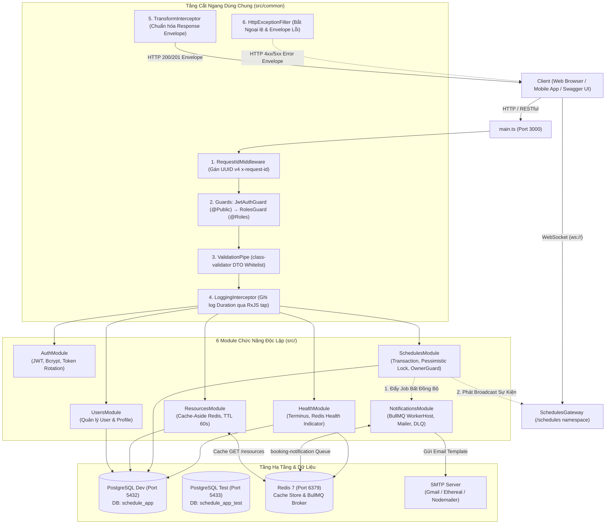
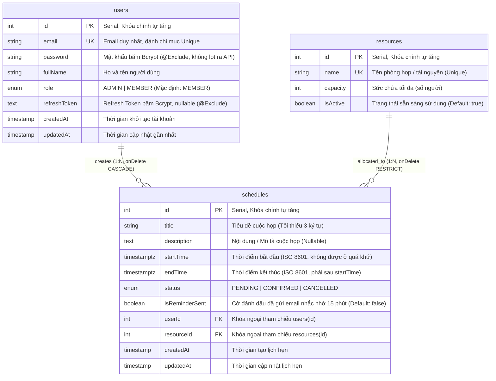

<div align="center">

# 🏢 Enterprise Scheduling & Resource Management Platform
### Nền tảng Đặt lịch & Quản lý Tài nguyên Doanh nghiệp Toàn diện

> **Đồ án môn học:** Các Công Nghệ Lập Trình Hiện Đại (CCNLTHD)  
> **Giảng viên hướng dẫn:** ThS. Phạm Thi Vương  
> **Nhóm thực hiện:** Nhóm 18  

[](https://nestjs.com/)
[](https://www.typescriptlang.org/)
[](https://www.postgresql.org/)
[](https://redis.io/)
[](https://bullmq.io/)
[](https://socket.io/)
[](http://localhost:3000/api/docs)
[-success?style=for-the-badge&logo=jest&logoColor=white)](https://jestjs.io/)

---

### 👥 Thành viên Nhóm 18
| STT | Họ và Tên        | Vai trò | Trách nhiệm chính |
| :---: | :---        | :---: | :--- |
| 1 | **Mai Hoàng Minh** | **Nhóm trưởng (Leader)** | Kiến trúc hệ thống, Request Lifecycle, Database Transaction, Pessimistic Locking, Quản lý tiến độ |
| 2 | **Nguyễn Đức Minh** | Thành viên | Authentication (JWT, Token Rotation, Bcrypt), RBAC, Ownership Guard, Security Audit |
| 3 | **Nguyễn Hoài Nam** | Thành viên | Resources Module, Redis Cache-Aside, BullMQ Background Queue & Dead Letter Queue (DLQ) |
| 4 | **Nguyễn Ngọc Hải** | Thành viên | Realtime WebSocket Gateway, Cron Tasks, Health Checks (Terminus), Swagger UI v2 & E2E Testing |

</div>

---

## 📑 Mục lục

1. [Tổng quan Dự án & Vấn đề Giải quyết](#-tổng-quan-dự-án--vấn-đề-giải-quyết)
2. [Kiến trúc Hệ thống & Vòng đời Request (Request Lifecycle)](#-kiến-trúc-hệ-thống--vòng-đời-request)
3. [Mô hình Dữ liệu Quan hệ (ERD & Indexing)](#-mô-hình-dữ-liệu-quan-hệ-erd--indexing)
4. [Các Trụ cột Kỹ thuật Nổi bật (Core Architectural Pillars)](#-các-trụ-cột-kỹ-thuật-nổi-bật)
   - [4.1. Khóa Bi quan (Pessimistic Concurrency Locking) & ACID Transaction](#41-khóa-bi-quan-pessimistic-concurrency-locking--acid-transaction)
   - [4.2. Bộ đệm Redis Cache-Aside & Chủ động Cache Invalidation](#42-bộ-đệm-redis-cache-aside--chủ-động-cache-invalidation)
   - [4.3. Hàng đợi Tác vụ Nền BullMQ, Idempotency & Dead Letter Queue (DLQ)](#43-hàng-đợi-tác-vụ-nền-bullmq-idempotency--dead-letter-queue-dlq)
   - [4.4. Đồng bộ Thời gian thực qua WebSocket Gateway (Socket.IO)](#44-đồng-bộ-thời-gian-thực-qua-websocket-gateway-socketio)
   - [4.5. Cơ chế Token Rotation & Bảo mật Lưu trữ Hash trong CSDL](#45-cơ-chế-token-rotation--bảo-mật-lưu-trữ-hash-trong-csdl)
   - [4.6. Tự động hóa Lập lịch Cronjob (@Cron Every Minute)](#46-tự-động-hóa-lập-lịch-cronjob-cron-every-minute)
   - [4.7. Giám sát Sức khỏe Toàn diện (Health Check Terminus)](#47-giám-sát-sức-khỏe-toàn-diện-health-check-terminus)
   - [4.8. Giao diện Swagger UI v2 Cá nhân hóa & Quick Authorize Bar](#48-giao-diện-swagger-ui-v2-cá-nhân-hóa--quick-authorize-bar)
5. [Bảng Công nghệ & Thư viện Hệ thống](#-bảng-công-nghệ--thư-viện-hệ-thống)
6. [Cấu trúc Thư mục Dự án](#-cấu-trúc-thư-mục-dự-án)
7. [Cấu hình Hạ tầng Docker & Phân tách Cơ sở Dữ liệu](#-cấu-hình-hạ-tầng-docker--phân-tách-cơ-sở-dữ-liệu)
8. [Hướng dẫn Cài đặt & Khởi chạy Nhanh](#-hướng-dẫn-cài-đặt--khởi-chạy-nhanh)
9. [Cấu hình Biến Môi trường (.env & .env.test)](#-cấu-hình-biến-môi-trường-env--envtest)
10. [Quản trị Cơ sở Dữ liệu (Migrations & Seeding)](#-quản-trị-cơ-sở-dữ-liệu-migrations--seeding)
11. [Danh mục Scripts trong package.json](#-danh-mục-scripts-trong-packagejson)
12. [Đặc tả Tài liệu API RESTful & WebSocket](#-đặc-tả-tài-liệu-api-restful--websocket)
13. [Chiến lược Kiểm thử & Đảm bảo Chất lượng (QA)](#-chiến-lược-kiểm-thử--đảm-bảo-chất-lượng-qa)
14. [Xử lý Sự cố Thường gặp (Troubleshooting)](#-xử-lý-sự-cố-thường-gặp-troubleshooting)
15. [Quy chuẩn Phát triển (Project Rules Compliance)](#-quy-chuẩn-phát-triển-project-rules-compliance)
16. [Giấy phép & Bản quyền (License)](#-giấy-phép--bản-quyền-license)

---

## 🌟 Tổng quan Dự án & Vấn đề Giải quyết

Trong môi trường doanh nghiệp có cường độ sử dụng cao (High Concurrency), các nền tảng đặt lịch phòng họp và tài nguyên dùng chung thường xuyên đối mặt với các thách thức kỹ thuật nghiêm trọng:
1. **Tranh chấp khung giờ (Race Condition & Double-Booking):** Khi nhiều người dùng cùng nhấn nút đặt một phòng họp trong cùng 1 mili-giây, hệ thống nếu chỉ dùng câu lệnh `SELECT` kiểm tra thông thường sẽ xảy ra hiện tượng **Phantom Read**, dẫn đến 2 lịch hẹn trùng nhau trên cùng một tài nguyên.
2. **Nghẽn tắc I/O (Blocking I/O Bottlenecks):** Việc gửi email thông báo xác nhận hoặc nhắc lịch trực tiếp trong luồng xử lý HTTP request làm tăng thời gian phản hồi (response latency) lên hàng giây và dễ làm sập kết nối khi dịch vụ mail bên ngoài gặp sự cố.
3. **Dữ liệu không đồng bộ (Stale Data & Polling Overload):** Người dùng phải liên tục tải lại trang (F5) hoặc client phải thực hiện HTTP Polling liên tục để cập nhật trạng thái phòng họp, gây lãng phí băng thông và tải máy chủ.
4. **Bộ nhớ đệm mất đồng bộ (Stale Cache):** Dữ liệu phòng họp trong CSDL đã bị chỉnh sửa hoặc xóa nhưng API vẫn trả về thông tin cũ từ cache Redis.
5. **Rủi ro rò rỉ Token (Token Hijacking & Stateless Leakage):** Sử dụng token JWT không thể thu hồi khi người dùng đăng xuất hoặc khi bị đánh cắp.

### 💡 Giải pháp Kiến trúc của Dự án (Phiên bản V2.0 Production-Ready):
- **Khóa Bi quan (Pessimistic Concurrency Locking):** Áp dụng row-level write lock (`pessimistic_write` / `SELECT ... FOR UPDATE`) bên trong Database Transaction để đảm bảo tính tuần tự tuyệt đối khi kiểm tra trùng lấn và lưu lịch hẹn.
- **Tác vụ Nền Bất đồng bộ với BullMQ & Redis:** Chuyển toàn bộ tác vụ gửi email sang Message Queue phân tán, trả response về cho client ngay lập tức trong vài mili-giây với cơ chế Retry Exponential Backoff và Dead Letter Queue (DLQ).
- **Phát sóng Đa kênh Thời gian thực (Realtime WebSocket):** Tự động phát sự kiện tới các client đang theo dõi theo từng Room tài nguyên (`resource_{id}`) qua Socket.IO.
- **Cache-Aside Pattern với Redis:** Cache danh mục tài nguyên phòng họp với TTL tự động và chủ động Invalidation cache ngay khi có thao tác thêm, sửa, xóa.
- **Bảo mật Xác thực Kép & Token Rotation:** Băm và lưu trữ `refreshToken` trong Database; cấp mới toàn bộ cặp token khi refresh và thu hồi ngay lập tức (`null`) khi logout.
- **Kiểm soát Toàn diện Vòng đời Request (Request Lifecycle Governance):** Chuẩn hóa 100% định dạng envelope phản hồi, logging hiệu năng theo thời gian thực và tự động tạo mã tương quan `x-request-id` phục vụ Distributed Tracing.

---

## 🏗️ Kiến trúc Hệ thống & Vòng đời Request

### 1. Sơ đồ Kiến trúc Tổng thể (Modular Monolith)



### 2. Chuỗi Vòng đời Request (Request Lifecycle Pipeline)

Mọi HTTP Request gửi tới server đều đi qua đúng 7 trạm kiểm soát nghiêm ngặt theo kiến trúc AOP (Aspect-Oriented Programming):

```text
[HTTP Request Đến]
       │
       ▼
[Trạm 1: RequestIdMiddleware] ────────► Trích xuất hoặc sinh mới UUID v4 gán vào header 'x-request-id'
       │
       ▼
[Trạm 2: JwtAuthGuard] ───────────────► Kiểm tra Token (@Public bypass; nạp req.user { sub, email, role })
       │
       ▼
[Trạm 3: RolesGuard] ─────────────────► So khớp @Roles() với user.role (ADMIN, MEMBER)
       │
       ▼
[Trạm 4: LoggingInterceptor (Pre)] ───► Ghi nhận thời điểm bắt đầu xử lý request (t0)
       │
       ▼
[Trạm 5: ValidationPipe] ─────────────► Whitelist DTO, kiểm tra class-validator, custom validators
       │
       ▼
[Trạm 6: Controller & Service] ───────► Thực thi nghiệp vụ (Pessimistic Lock, Transaction, Cache, Queue)
       │
       ▼
[Trạm 7: TransformInterceptor] ───────► Đóng gói dữ liệu vào cấu trúc { success: true, statusCode, data, timestamp }
       │
       ▼
[LoggingInterceptor (Post)] ──────────► Tính delta thời gian (t1 - t0) ms và in log chuẩn
       │
       ▼
[HTTP Response Trả Về Client]

* Nếu phát sinh lỗi ở bất kỳ trạm nào ──► [HttpExceptionFilter] bắt lỗi, format chuẩn { success: false, statusCode, errorCode, message, requestId, timestamp, path }
```

---

## 🗄️ Mô hình Dữ liệu Quan hệ (ERD & Indexing)



> ⚡ **Tối ưu hóa Truy vấn với Composite Index:**  
> Bảng `schedules` được trang bị **Composite Index** `IDX_68a8c8edbbc6b891a0f2e68ddf` trên bộ 3 cột:  
> `("resourceId", "startTime", "endTime")`  
> Giúp truy vấn kiểm tra trùng lấn thời gian (`overlap query`) đạt độ phức tạp $O(\log N)$ thay vì quét toàn bộ bảng (Table Scan).

---

## 💎 Các Trụ cột Kỹ thuật Nổi bật

### 4.1. Khóa Bi quan (Pessimistic Concurrency Locking) & ACID Transaction
Để triệt tiêu hoàn toàn nguy cơ **Double-Booking** khi có nhiều request đồng thời, [`SchedulesService.create()`](src/schedules/schedules.service.ts) thực thi quy trình đặt lịch trong một Database Transaction có khóa cấp độ dòng:

```typescript
return await this.dataSource.transaction(async (manager) => {
  // 1. Áp dụng Khóa Bi quan (Row-level Write Lock: SELECT ... FOR UPDATE)
  const resource = await manager
    .getRepository(Resource)
    .createQueryBuilder('resource')
    .setLock('pessimistic_write')
    .where('resource.id = :id', { id: createScheduleDto.resourceId })
    .getOne();

  if (!resource || !resource.isActive) {
    throw new NotFoundException('Tài nguyên phòng họp không tồn tại hoặc đang tạm ngưng hoạt động!');
  }

  // 2. Kiểm tra trùng lấn khung giờ với các lịch PENDING hoặc CONFIRMED
  const overlappingSchedule = await manager
    .getRepository(Schedule)
    .createQueryBuilder('schedule')
    .where('schedule.resourceId = :resourceId', { resourceId: resource.id })
    .andWhere('schedule.status IN (:...statuses)', {
      statuses: [ScheduleStatus.PENDING, ScheduleStatus.CONFIRMED],
    })
    .andWhere('schedule.startTime < :endTime AND schedule.endTime > :startTime', {
      startTime: createScheduleDto.startTime,
      endTime: createScheduleDto.endTime,
    })
    .getOne();

  if (overlappingSchedule) {
    throw new ConflictException('Phòng họp đã được đặt trong khung giờ này. Vui lòng chọn thời gian khác!');
  }

  // 3. Lưu lịch hẹn nguyên tử
  const schedule = manager.getRepository(Schedule).create({ ...createScheduleDto, userId });
  return await manager.getRepository(Schedule).save(schedule);
});
```

#### Mô phỏng Rollback Giao dịch (`POST /schedules/test-rollback`):
Endpoint này khởi tạo transaction, lấy khóa tài nguyên, lưu một bản ghi lịch hẹn thành công, sau đó **chủ động ném ra ngoại lệ hệ thống** (`InternalServerErrorException`) trước khi commit. Kết quả kiểm chứng qua bài test E2E: Database tự động thực hiện **Rollback 100%**, không có bất kỳ bản ghi rác nào tồn tại trong CSDL.

---

### 4.2. Bộ đệm Redis Cache-Aside & Chủ động Cache Invalidation
Áp dụng cho danh mục tài nguyên phòng họp (`GET /resources`) để tối ưu tốc độ đọc dữ liệu:
- **Cache-Aside Pattern:** Khi nhận request mặc định (`page=1, limit=10`, không filter), hệ thống kiểm tra key `resources_default` trên Redis. Nếu có (Cache Hit), trả dữ liệu ngay trong < 2ms. Nếu không có (Cache Miss), truy vấn CSDL, lưu vào Redis với TTL 60 giây và trả về cho client.
- **Cache Invalidation:** Khi có bất kỳ hành động ghi nào làm thay đổi dữ liệu (`POST /resources`, `PATCH /resources/:id`, `DELETE /resources/:id`), [`ResourcesService`](src/resources/resources.service.ts) lập tức gọi `this.cacheManager.del('resources_default')`, triệt tiêu hoàn toàn nguy cơ Stale Data.

---

### 4.3. Hàng đợi Tác vụ Nền BullMQ, Idempotency & Dead Letter Queue (DLQ)
Tách rời hoàn toàn các tác vụ I/O nặng (gửi email thông báo) ra khỏi vòng đời HTTP:
- **Non-blocking Dispatch:** Sau khi lịch hẹn được lưu thành công, server đẩy một Job vào BullMQ Queue `booking-notification` và trả response HTTP 201 cho client ngay lập tức (~10-15ms).
- **Tính Lũy Đẳng (Idempotency Key):** Mỗi job được định danh duy nhất bằng thuộc tính `jobId` (`schedule_${id}` cho email xác nhận, `reminder_${id}` cho email nhắc nhở). Khi có lỗi mạng dẫn đến retry, BullMQ tự động nhận diện `jobId` đã tồn tại và không gửi lặp email cho người dùng.
- **Khả năng Tự phục hồi (Resilience & Exponential Backoff):** Cấu hình tự động thử lại 3 lần với thời gian chờ tăng theo cấp số nhân (`attempts: 3`, `backoff: { type: 'exponential', delay: 2000 }`).
- **Dead Letter Queue (DLQ):** Khi một job thất bại vượt quá số lần thử tối đa, sự kiện `Worker.on('failed')` trong [`NotificationProcessor`](src/notifications/notification.processor.ts) sẽ ghi log lỗi cảnh báo phân loại DLQ và lưu vết phục vụ việc điều tra sự cố.

---

### 4.4. Đồng bộ Thời gian thực qua WebSocket Gateway (Socket.IO)
- **Namespace:** `/schedules`
- **Xác thực Kết nối (Handshake JWT Guard):** Client bắt buộc phải truyền JWT Access Token qua `auth.token` hoặc header `authorization: Bearer <token>`. Nếu token không hợp lệ hoặc thiếu, Gateway từ chối kết nối ngay từ tầng bắt tay.
- **Room Multiplexing:** Client đăng ký lắng nghe phòng họp cụ thể bằng sự kiện `joinRoom` với payload `{ resourceId: 1 }`. Socket sẽ gia nhập Room `resource_1`.
- **Broadcast Sự kiện Tức thời:**
  * Khi tạo lịch mới: Phát sự kiện `scheduleCreated` kèm thông tin lịch hẹn tới toàn bộ client trong Room `resource_{id}`.
  * Khi hủy lịch: Phát sự kiện `scheduleCancelled` kèm `{ id: scheduleId }`.
- **Giao diện Kiểm thử Đa Client:** Cung cấp sẵn tệp [`test/ws-multi-client-tester.html`](test/ws-multi-client-tester.html) mô phỏng đồng thời nhiều client tham gia các room khác nhau và nhận thông báo theo thời gian thực.

---

### 4.5. Cơ chế Token Rotation & Bảo mật Lưu trữ Hash trong CSDL
Hệ thống sử dụng cơ chế xác thực Token Song hành (Access Token & Refresh Token) đạt chuẩn bảo mật ngân hàng:
- **Access Token:** Hạn dùng ngắn (mặc định 1 ngày hoặc 5 phút theo config), chứa payload `{ sub: user.id, email: user.email, role: user.role }`.
- **Lưu trữ Refresh Token đã Băm:** Khi đăng nhập, `refreshToken` được băm bằng `bcrypt.hash(..., 10)` và lưu vào cột `users.refreshToken` trong CSDL.
- **Token Rotation:** Khi client gọi `POST /auth/refresh`, server xác thực chữ ký token, so khớp chuỗi băm trong CSDL bằng `bcrypt.compare`, sau đó **hủy refresh token cũ và sinh mới cả cặp Access Token + Refresh Token mới**, đồng thời cập nhật chuỗi băm mới vào CSDL.
- **Thu hồi Token Tức thì (Revocation):** Khi người dùng gọi `POST /auth/logout`, server cập nhật `users.refreshToken = null`, vô hiệu hóa vĩnh viễn khả năng làm mới phiên làm việc.

---

### 4.6. Tự động hóa Lập lịch Cronjob (@Cron Every Minute)
[`ScheduleTasksService`](src/schedules/tasks/schedule-tasks.service.ts) chạy tự động mỗi phút một lần (`@Cron(CronExpression.EVERY_MINUTE)`):
1. **Chủ động Nhắc lịch trước 15 phút:** Quét các lịch hẹn ở trạng thái `CONFIRMED` có thời gian bắt đầu nằm trong khung `[Hiện tại + 14 phút, Hiện tại + 15 phút]` và có `isReminderSent = false`. Hệ thống đẩy job nhắc nhở vào BullMQ và đánh dấu `isReminderSent = true`.
2. **Tự động Hủy lịch Quá hạn:** Quét các lịch hẹn vẫn còn ở trạng thái `PENDING` nhưng đã quá giờ bắt đầu (`startTime < NOW()`), tự động chuyển trạng thái sang `CANCELLED`.

---

### 4.7. Giám sát Sức khỏe Toàn diện (Health Check Terminus)
Endpoint công khai `GET /health` tích hợp thư viện `@nestjs/terminus` kiểm tra đồng thời 4 chỉ số sinh tồn của hệ thống:
- **Database Health:** `TypeOrmHealthIndicator.pingCheck('database')` kiểm tra tính thông suốt của kết nối PostgreSQL.
- **Custom Redis Health:** [`RedisHealthIndicator`](src/health/redis.health.ts) tạo kết nối socket trực tiếp tới Redis Server, gửi lệnh RESP `PING` và kiểm tra phản hồi `+PONG` với timeout bảo vệ.
- **Memory Heap Check:** `MemoryHealthIndicator.checkHeap('memory_heap', 300 * 1024 * 1024)` cảnh báo nếu dung lượng bộ nhớ Heap vượt quá 300MB.
- **Memory RSS Check:** `MemoryHealthIndicator.checkRSS('memory_rss', 500 * 1024 * 1024)` cảnh báo nếu dung lượng bộ nhớ RSS vượt quá 500MB.

---

### 4.8. Giao diện Swagger UI 
Tài liệu tương tác API tại `http://localhost:3000/api/docs` được thiết kế lại toàn diện:
- **Phong cách Thiết kế Light Minimalism:** Sử dụng font chữ hiện đại (Inter, JetBrains Mono), đường nét tối giản, màu sắc dịu mắt.
- **Thông tin Nhóm Đồ án Tích hợp:** Hiển thị trang trọng đề tài, thông tin môn học, GVHD ThS. Phạm Thi Vương và danh sách 4 thành viên Nhóm 18 ở đầu trang.
- **Thanh Công Cụ Đăng Nhập Nhanh (Quick Authorize Bar):**
  * Tích hợp sẵn 3 nút 1-click test nhanh: **admin** (`admin@example.com`), **member1** (`member1@example.com`), **member2** (`member2@example.com`).
  * Khi click, hệ thống tự động gọi API `POST /auth/login`, nhận token, lưu vào danh sách chọn và tự động điền vào hộp thoại Authorize của Swagger UI.
  * Hiển thị thông báo Toast Notification chuyên nghiệp thay cho các hộp thoại alert truyền thống.

---

## 🛠️ Bảng Công nghệ & Thư viện Hệ thống

| Phân loại | Công nghệ / Thư viện | Phiên bản | Vai trò & Mục đích sử dụng |
| :--- | :--- | :---: | :--- |
| **Framework Lõi** | NestJS Core & Common | `11.0.1` | Kiến trúc Modular Monolith, IoC / DI Container, Request Lifecycle |
| **Nền tảng HTTP** | Express Engine | `^5.0.0` | Nền tảng tiếp nhận HTTP Request / Response |
| **Ngôn ngữ** | TypeScript | `5.7.3` | Lập trình hướng đối tượng có định kiểu tĩnh, Decorator Reflection |
| **Cơ sở Dữ liệu** | PostgreSQL (Docker) | `16-alpine` | Hệ quản trị CSDL quan hệ chính (ACID, Pessimistic Locking) |
| **ORM** | TypeORM | `0.3.31` | Quản lý Entity, Data Source, Migration CLI, QueryBuilder |
| **Bộ đệm & Broker**| Redis (Docker) | `7-alpine` | In-memory Cache Store và Message Broker cho BullMQ |
| **Cache Adapter** | Cache-Manager + Keyv | `^7.2.9` / `^5.1.6` | Adapter kết nối Redis cho module Caching của NestJS |
| **Hàng đợi Phân tán**| BullMQ | `5.41.0` | Quản lý hàng đợi nền, WorkerHost, Retry Backoff, DLQ |
| **Giao tiếp Realtime**| Socket.IO + Nest WebSockets| `4.8.4` / `11.0.1` | WebSocket Gateway, Room Multiplexing, Event Broadcast |
| **Tác vụ Lập lịch** | NestJS Schedule | `6.1.3` | Cron jobs định kỳ quét nhắc lịch và dọn dẹp dữ liệu |
| **Giám sát Sinh tồn**| NestJS Terminus | `11.1.1` | Health Check tổng thể kết nối Database, Redis và Bộ nhớ RAM |
| **Dịch vụ Email** | NestJS Mailer + Nodemailer | `3.0.2` / `10.2.0` | Gửi email thông báo qua giao thức SMTP |
| **Xác thực & Mã hóa**| Passport JWT + Bcrypt | `^4.0.1` / `6.0.0` | Sinh/giải mã JWT token và băm mật khẩu / refresh token |
| **Validation Dữ liệu**| Class-Validator & Transformer | `0.15.1` / `0.5.1` | Xác thực dữ liệu DTO đầu vào, Custom Decorator Validators |
| **Tài liệu Hóa API** | NestJS Swagger (OpenAPI 3) | `11.4.7` | Giao diện khám phá và kiểm thử API tương tác tại `/api/docs` |
| **Kiểm thử Đơn vị** | Jest + Ts-Jest | `30.0.0` / `29.2.5` | Test Runner cho bộ kiểm thử Unit Tests |
| **Kiểm thử Tích hợp**| Supertest | `7.0.0` | Thư viện giả lập HTTP Request cho E2E Integration Tests |

---

## 📂 Cấu trúc Thư mục Dự án

```text
CCNLTHD_Nestjs/
├── src/
│   ├── app.controller.ts                # Route gốc (/) và route kiểm tra phân quyền (/admin-only)
│   ├── app.module.ts                    # Root Module kết nối toàn bộ 6 module và cấu hình IoC Providers
│   ├── data-source.ts                   # TypeORM Data Source cấu hình kết nối DB Dev (port 5432)
│   ├── data-source-test.ts              # TypeORM Data Source chuyên dụng kết nối DB Test (port 5433)
│   ├── main.ts                          # Bootstrap file khởi chạy ứng dụng, ValidationPipe, Swagger UI
│   ├── auth/                            # Module Xác thực người dùng
│   │   ├── dto/                         # LoginDto, RegisterDto, RefreshTokenDto
│   │   ├── strategies/                  # JwtStrategy (Passport JWT extraction & validation)
│   │   ├── auth.controller.ts           # Endpoints: /auth/login, /register, /refresh, /logout, /profile
│   │   ├── auth.module.ts
│   │   ├── auth.service.spec.ts         # Unit test cho logic xác thực
│   │   └── auth.service.ts              # Xử lý đăng nhập, băm mật khẩu, Token Rotation
│   ├── common/                          # Các thành phần cắt ngang dùng chung (Cross-Cutting Concerns)
│   │   ├── decorators/                  # @CurrentUser(), @Public(), @Roles()
│   │   ├── filters/                     # HttpExceptionFilter (Bắt ngoại lệ & format envelope lỗi)
│   │   ├── guards/                      # JwtAuthGuard (Global), RolesGuard (RBAC)
│   │   ├── interceptors/                # LoggingInterceptor, TransformInterceptor (Global Envelope)
│   │   └── middlewares/                 # RequestIdMiddleware (Sinh UUID x-request-id)
│   ├── health/                          # Module Giám sát Sức khỏe Hệ thống
│   │   ├── health.controller.ts         # Endpoint: GET /health (Terminus)
│   │   ├── health.module.ts
│   │   ├── redis.health.ts              # Custom Redis Health Indicator (Socket RESP Ping)
│   │   └── redis.health.spec.ts         # Unit test cho Redis Health Indicator
│   ├── migrations/                      # Các tệp Migration TypeORM quản lý phiên bản CSDL
│   │   ├── 1791715452494-InitialSchedulingSchema.ts
│   │   ├── 1791719730974-AddRefreshTokenToUser.ts
│   │   └── 1791858496631-AddIsReminderSentToSchedule.ts
│   ├── notifications/                   # Module Xử lý Tác vụ Nền qua BullMQ
│   │   ├── notification.processor.ts    # BullMQ WorkerHost xử lý gửi email xác nhận & nhắc lịch
│   │   ├── notification.processor.spec.ts# Unit test cho BullMQ Worker và Dead Letter Queue
│   │   └── notifications.module.ts
│   ├── resources/                       # Module Quản lý Tài nguyên Phòng họp
│   │   ├── dto/                         # CreateResourceDto, UpdateResourceDto, QueryResourceDto
│   │   ├── entities/                    # Resource Entity (TypeORM)
│   │   ├── resources.controller.ts      # Endpoints: GET, POST, PATCH, DELETE /resources
│   │   ├── resources.module.ts
│   │   └── resources.service.ts         # Nghiệp vụ tài nguyên kèm Redis Cache-Aside & Invalidation
│   ├── schedules/                       # Module Quản lý Lịch hẹn & Đặt chỗ Cốt lõi
│   │   ├── dto/                         # CreateScheduleDto, UpdateScheduleDto, QueryScheduleDto, StatusDto
│   │   ├── entities/                    # Schedule Entity với Composite Index
│   │   ├── enums/                       # ScheduleStatus (PENDING, CONFIRMED, CANCELLED)
│   │   ├── gateways/                    # SchedulesGateway (WebSocket namespace /schedules)
│   │   ├── guards/                      # ScheduleOwnershipGuard (Chính chủ hoặc Admin mới được sửa/hủy)
│   │   ├── tasks/                       # ScheduleTasksService (Cron jobs mỗi phút nhắc lịch & hủy quá hạn)
│   │   ├── validators/                  # Custom Validators: @IsAfter(), @IsNotPastDate()
│   │   ├── schedules.controller.ts      # Endpoints CRUD lịch hẹn và /schedules/test-rollback
│   │   ├── schedules.module.ts
│   │   └── schedules.service.ts         # Nghiệp vụ đặt lịch với Khóa bi quan và Transaction
│   ├── seeds/                           # Script khởi tạo dữ liệu mẫu CSDL
│   │   └── script.ts                    # Seed users, resources và schedules ban đầu
│   ├── swagger/                         # Cấu hình Swagger UI v2 & Theme Tùy biến
│   │   ├── docs/                        # Decorators tài liệu OpenAPI cho từng Controller
│   │   ├── swagger-theme.ts             # Template giao diện Minimalism, Quick Authorize Bar, Toast JS
│   │   └── swagger.config.ts            # Khởi tạo DocumentBuilder và nạp Swagger
│   └── users/                           # Module Quản lý Người dùng
│       ├── entities/                    # User Entity với vai trò Role (ADMIN, MEMBER)
│       ├── enums/                       # Role Enum
│       ├── users.module.ts
│       └── users.service.ts
├── test/                                # Thư mục Chứa Bộ Kiểm thử Tự động E2E
│   ├── app.e2e-spec.ts                  # Bộ kiểm thử E2E tích hợp REST API toàn diện (50 test cases)
│   ├── schedules.gateway.e2e-spec.ts    # Bộ kiểm thử E2E tích hợp WebSocket Realtime
│   ├── setup-test-env.ts                # Nạp biến môi trường .env.test trước khi chạy Jest E2E
│   ├── test-seed.helper.ts              # Helper tự động seed tài khoản và phòng họp cho DB Test
│   ├── jest-e2e.json                    # Cấu hình Jest E2E (maxWorkers: 1, setupFiles)
│   └── ws-multi-client-tester.html      # Giao diện Web kiểm thử WebSocket đa client trực quan
├── report/                              # Báo cáo Tiến độ Từng Bước Thực hiện (prompt_1.md -> prompt_14.md)
├── docker-compose.yml                   # Cấu hình Docker Compose cho Postgres Dev, Postgres Test và Redis
├── package.json                         # Danh mục Thư viện, Dependencies và Scripts thực thi
├── tsconfig.json                        # Cấu hình TypeScript Compiler
├── .env.example                         # Tệp tin mẫu hướng dẫn khai báo biến môi trường
└── README.md                            # Tài liệu Hướng dẫn Toàn diện của Dự án
```

---

## 🐳 Cấu hình Hạ tầng Docker & Phân tách Cơ sở Dữ liệu

Tệp [`docker-compose.yml`](docker-compose.yml) được thiết kế theo chuẩn phân tách môi trường, chia biệt lập giữa Database Phát triển và Database Kiểm thử:

```yaml
services:
  # 1. Cơ sở Dữ liệu Chính (Môi trường Dev & Runtime)
  postgres:
    image: postgres:16-alpine
    container_name: todos-postgres-ccnlthd
    environment:
      POSTGRES_USER: 
      POSTGRES_PASSWORD:
      POSTGRES_DB: schedule_app
    ports:
      - "5432:5432"
    volumes:
      - postgres_data:/var/lib/postgresql/data

  # 2. Cơ sở Dữ liệu Độc lập phục vụ Kiểm thử Tự động (Môi trường E2E Test)
  postgres-test:
    image: postgres:16-alpine
    container_name: todos-postgres-test-ccnlthd
    environment:
      POSTGRES_USER:
      POSTGRES_PASSWORD:
      POSTGRES_DB: schedule_app_test
    ports:
      - "5433:5432" # Port Host 5433 -> Port Container 5432
    volumes:
      - postgres_test_data:/var/lib/postgresql/data

  # 3. Redis In-Memory Cache & Message Broker cho BullMQ
  redis:
    image: redis:7-alpine
    container_name: todos-redis-ccnlthd
    ports:
      - "6379:6379"
    volumes:
      - redis_data:/data
```

### 🔒 Lợi ích của Cơ chế Phân tách Database:
- **Tuyệt đối An toàn cho Dữ liệu Dev:** Quá trình chạy test E2E thực hiện hàng trăm thao tác tạo, sửa, xóa, rollback dữ liệu giả lập nhưng hoàn toàn diễn ra trên cổng `5433` (`schedule_app_test`). Database dev trên cổng `5432` (`schedule_app`) không bị ảnh hưởng hay nhiễm dữ liệu rác.
- **Tính Sẵn sàng Cao:** Kiểm thử viên có thể chạy `npm run test:e2e` bất kỳ lúc nào mà không cần dừng server phát triển hay lo sợ xung đột khóa tài nguyên.

---

## 🚀 Hướng dẫn Cài đặt & Khởi chạy Nhanh

### 1. Yêu cầu Tiên quyết
- **Node.js:** Phiên bản `v18.x`, `v20.x`, hoặc `v22.x` (khuyến nghị `v22.10+`).
- **NPM:** Phiên bản `v9.x` hoặc `v10.x` (khuyến nghị `v10.9+`).
- **Docker & Docker Compose:** Đã cài đặt và đang chạy Docker Desktop.

### 2. Các Bước Cài đặt Chi tiết

```bash
# Bước 1: Clone kho mã nguồn từ GitHub
git clone https://github.com/minhmhit/CCNLTHD_Nestjs.git
cd CCNLTHD_Nestjs

# Bước 2: Cài đặt toàn bộ dependencies
npm install

# Bước 3: Khởi chạy các container hạ tầng qua Docker Compose
docker compose up -d

# Kiểm tra trạng thái các container (phải hiển thị 3 container đang Up)
docker compose ps
```

### 3. Cấu hình Biến Môi trường
Sao chép tệp mẫu sang `.env` và `.env.test`:
```bash
# Trên Linux / macOS:
cp .env.example .env
cp .env.example .env.test

# Trên Windows PowerShell:
Copy-Item .env.example .env
Copy-Item .env.example .env.test
```

### 4. Thực thi Database Migrations & Nạp Dữ liệu Mẫu (Seed)
```bash
# Chạy migration tạo cấu trúc bảng trên CSDL Dev (port 5432)
npm run migration:run

# Nạp dữ liệu mẫu ban đầu (tài khoản admin/member, phòng họp)
npm run seed

# (Tùy chọn) Chạy migration trên CSDL Test (port 5433) để phục vụ kiểm thử
npm run migration:run:test
```

### 5. Khởi động Ứng dụng
```bash
# Chạy ở chế độ phát triển (Development Watch Mode)
npm run start:dev
```

Sau khi khởi chạy thành công:
- **REST API Base URL:** `http://localhost:3000`
- **Swagger UI v2 Documentation:** `http://localhost:3000/api/docs`
- **Health Check Endpoint:** `http://localhost:3000/health`
- **WebSocket Realtime Namespace:** `ws://localhost:3000/schedules`

---

## ⚙️ Cấu hình Biến Môi trường (.env & .env.test)

Hệ thống sử dụng `@nestjs/config` tự động nạp `.env` ở môi trường thông thường và `.env.test` khi `NODE_ENV === 'test'`:

| Biến Môi trường | Ý nghĩa & Mô tả | Giá trị Mẫu (.env Dev) | Giá trị Mẫu (.env.test) |
| :--- | :--- | :--- | :--- |
| `NODE_ENV` | Môi trường thực thi của ứng dụng | `development` | `test` |
| `PORT` | Cổng HTTP Server lắng nghe | `3000` | `3000` |
| `DB_HOST` | Địa chỉ máy chủ PostgreSQL | `localhost` | `localhost` |
| `DB_PORT` | Cổng kết nối PostgreSQL | `5432` | `5433` *(DB Test riêng biệt)* |
| `DB_USER` | Tên tài khoản quản trị CSDL | `admin` | `admin` |
| `DB_PASSWORD` | Mật khẩu truy cập CSDL | `admin123` | `admin123` |
| `DB_NAME` | Tên cơ sở dữ liệu | `schedule_app` | `schedule_app_test` |
| `JWT_SECRET` | Khóa bí mật ký JWT Access Token | `your_access_secret_key` | `your_access_secret_key` |
| `JWT_EXPIRES_IN` | Thời gian sống của Access Token | `1d` | `1d` |
| `JWT_REFRESH_SECRET` | Khóa bí mật ký JWT Refresh Token | `your_refresh_secret_key`| `your_refresh_secret_key`|
| `JWT_REFRESH_EXPIRES_IN`| Thời hạn sống của Refresh Token | `7d` | `7d` |
| `REDIS_HOST` | Địa chỉ máy chủ Redis | `localhost` | `localhost` |
| `REDIS_PORT` | Cổng kết nối Redis | `6379` | `6379` |
| `MAIL_HOST` | Địa chỉ máy chủ SMTP gửi mail | `smtp.gmail.com` | `smtp.gmail.com` |
| `MAIL_PORT` | Cổng kết nối SMTP | `587` | `587` |
| `MAIL_USER` | Tài khoản gửi email | `your_email@gmail.com` | `test@example.com` |
| `MAIL_PASS` | Mật khẩu ứng dụng (App Password) | `your_app_password` | `testpass` |
| `MAIL_FROM` | Tên hiển thị người gửi email | `"Scheduling App <no-reply@app.com>"` | `"Scheduling App <no-reply@app.com>"` |

---

## 🗃️ Quản trị Cơ sở Dữ liệu (Migrations & Seeding)

### 1. Danh sách các bản Migration TypeORM
Hệ thống tuân thủ nghiêm ngặt **Điều 4** (cấm bật `synchronize: true` ở production). Toàn bộ cấu trúc bảng được kiểm soát qua 3 bản migration trong `src/migrations/`:
1. `1791715452494-InitialSchedulingSchema.ts`: Khởi tạo bảng `resources`, `users`, `schedules` kèm các kiểu ENUM và Composite Index.
2. `1791719730974-AddRefreshTokenToUser.ts`: Bổ sung cột `refreshToken` kiểu `text` (nullable) vào bảng `users`.
3. `1791858496631-AddIsReminderSentToSchedule.ts`: Bổ sung cột `isReminderSent` kiểu `boolean` (default `false`) vào bảng `schedules`.

### 2. Tài khoản Mẫu có sẵn (Sau khi chạy `npm run seed`)
| Email | Password | Role | Họ và Tên | Mô tả Quyền hạn |
| :--- | :--- | :---: | :--- | :--- |
| `admin@example.com` | `password123` | `ADMIN` | Admin System | Toàn quyền thêm, sửa, xóa phòng họp và quản lý toàn bộ lịch hẹn |
| `member1@example.com` | `password123` | `MEMBER` | Nguyen Van A | Thành viên thông thường, chỉ sửa/hủy được lịch do chính mình tạo |
| `member2@example.com` | `password123` | `MEMBER` | Tran Thi B | Thành viên thông thường |

### 3. Phòng họp Mẫu có sẵn
- **Phòng họp Tokyo:** Sức chứa 10 người, trạng thái hoạt động (`isActive = true`).
- **Hội trường Diamond:** Sức chứa 50 người, trạng thái hoạt động (`isActive = true`).
- **Phòng Cố vấn 1:** Sức chứa 4 người, trạng thái hoạt động (`isActive = true`).

---

## 📜 Danh mục Scripts trong package.json

| Lệnh Thực thi | Mô tả Chi tiết Chức năng |
| :--- | :--- |
| `npm run start` | Khởi chạy ứng dụng với Nest CLI thông thường |
| `npm run start:dev` | Khởi chạy server chế độ Watch Mode (tự biên dịch lại khi sửa file) |
| `npm run start:prod` | Khởi chạy bản build sản phẩm từ thư mục `dist/main.js` |
| `npm run build` | Biên dịch toàn bộ mã nguồn TypeScript sang JavaScript tại `dist/` |
| `npm run format` | Tự động định dạng toàn bộ mã nguồn theo chuẩn Prettier |
| `npm run lint` | Quét kiểm tra lỗi cú pháp và chất lượng mã nguồn bằng ESLint |
| `npm test` | Chạy toàn bộ **Unit Tests** (10 test suites, 58 test cases) |
| `npm run test:watch` | Chạy Unit Tests ở chế độ theo dõi tương tác |
| `npm run test:cov` | Xuất báo cáo độ bao phủ mã nguồn (Code Coverage Report) |
| `npm run test:e2e` | Chạy toàn bộ **E2E Integration Tests** trên Database Test (port 5433) |
| `npm run seed` | Thực thi script nạp dữ liệu mẫu ban đầu vào cơ sở dữ liệu Dev |
| `npm run migration:run` | Chạy toàn bộ các migration chưa được áp dụng trên DB Dev (port 5432) |
| `npm run migration:revert` | Revert bản migration gần nhất trên DB Dev |
| `npm run migration:run:test` | Chạy toàn bộ migration trên **DB Test riêng biệt** (port 5433) |
| `npm run migration:revert:test` | Revert bản migration gần nhất trên DB Test |

---

## 📡 Đặc tả Tài liệu API RESTful & WebSocket

### 1. Chuẩn hóa Định dạng Phản hồi (Standard Response Envelopes)

#### Phản hồi Thành công (Được đóng gói tự động qua `TransformInterceptor`):
```json
{
  "success": true,
  "statusCode": 200,
  "data": { ... },
  "timestamp": "2026-10-26T18:00:00.000Z"
}
```

#### Phản hồi Thất bại (Được xử lý tập trung qua `HttpExceptionFilter`):
```json
{
  "success": false,
  "statusCode": 409,
  "errorCode": "ConflictException",
  "message": "Phòng họp đã được đặt trong khung giờ này. Vui lòng chọn thời gian khác!",
  "requestId": "a0f8b1c2-3d4e-5f6a-7b8c-9d0e1f2a3b4c",
  "timestamp": "2026-10-26T18:00:00.000Z",
  "path": "/schedules"
}
```

---

### 2. Danh mục 20 Endpoints API RESTful Chi tiết

#### Nhóm 1: Xác thực & Quản lý Phiên (`/auth`)
| HTTP Method | Endpoint | Yêu cầu Quyền | Mô tả Nghiệp vụ |
| :---: | :--- | :---: | :--- |
| `POST` | `/auth/register` | `@Public()` | Đăng ký tài khoản người dùng mới (`email`, `password`, `fullName`) |
| `POST` | `/auth/login` | `@Public()` | Đăng nhập; trả về `accessToken`, `refreshToken` và thông tin user |
| `POST` | `/auth/refresh` | `@Public()` | Cấp mới cặp token qua cơ chế Token Rotation |
| `POST` | `/auth/logout` | Authenticated | Đăng xuất; xóa chuỗi hash refresh token trong CSDL (`null`) |
| `GET` | `/auth/profile` | Authenticated | Trích xuất thông tin người dùng từ JWT Token hiện hành |

#### Nhóm 2: Quản lý Tài nguyên Phòng họp (`/resources`)
| HTTP Method | Endpoint | Yêu cầu Quyền | Mô tả Nghiệp vụ |
| :---: | :--- | :---: | :--- |
| `GET` | `/resources` | Authenticated | Lấy danh mục tài nguyên phân trang, có filter (Áp dụng Redis Cache-Aside) |
| `GET` | `/resources/:id` | Authenticated | Lấy chi tiết tài nguyên theo ID qua `ParseIntPipe` |
| `POST` | `/resources` | `@Roles(Role.ADMIN)` | Thêm mới tài nguyên phòng họp; tự động xóa cache Redis |
| `PATCH` | `/resources/:id` | `@Roles(Role.ADMIN)` | Cập nhật thông tin tài nguyên; tự động xóa cache Redis |
| `DELETE` | `/resources/:id` | `@Roles(Role.ADMIN)` | Xóa tài nguyên phòng họp; tự động xóa cache Redis |

#### Nhóm 3: Quản lý Lịch biểu & Đặt chỗ (`/schedules`)
| HTTP Method | Endpoint | Yêu cầu Quyền | Mô tả Nghiệp vụ |
| :---: | :--- | :---: | :--- |
| `GET` | `/schedules` | Authenticated | Lấy danh sách lịch hẹn phân trang, lọc theo `resourceId`, khoảng thời gian |
| `GET` | `/schedules/:id` | Authenticated | Lấy chi tiết lịch hẹn theo ID |
| `POST` | `/schedules` | Authenticated | Đặt lịch phòng họp: Khóa bi quan, kiểm tra trùng lấn, đẩy job BullMQ, phát WebSocket |
| `POST` | `/schedules/test-rollback` | Authenticated | Mô phỏng lỗi hệ thống trong transaction để kiểm chứng Rollback tự động |
| `PATCH` | `/schedules/:id` | Admin hoặc Creator | Cập nhật thời gian hoặc phòng họp (chỉ cho phép khi chưa CANCELLED) |
| `PATCH` | `/schedules/:id/status` | Admin hoặc Creator | Chuyển đổi trạng thái lịch theo FSM (`PENDING` -> `CONFIRMED` -> `CANCELLED`) |
| `DELETE` | `/schedules/:id` | Admin hoặc Creator | Hủy lịch hẹn (Soft cancel: đổi status sang `CANCELLED` và phát broadcast) |

#### Nhóm 4: Giám sát Hệ thống & Kiểm tra Route Cơ bản
| HTTP Method | Endpoint | Yêu cầu Quyền | Mô tả Nghiệp vụ |
| :---: | :--- | :---: | :--- |
| `GET` | `/` | `@Public()` | Route chào đón mặc định của hệ thống |
| `GET` | `/admin-only` | `@Roles(Role.ADMIN)` | Route kiểm chứng phân quyền nghiêm ngặt dành riêng cho quản trị viên |
| `GET` | `/health` | `@Public()` | Kiểm tra sức khỏe toàn diện (Database, Redis socket, Memory Heap/RSS) |

---

### 3. Đặc tả Realtime WebSocket Gateway (`/schedules`)

- **Địa chỉ kết nối:** `ws://localhost:3000/schedules`
- **Giao thức hỗ trợ:** `websocket`, `polling`
- **Xác thực Handshake:** Bắt buộc truyền Token qua đối tượng kết nối:
  ```javascript
  const socket = io('http://localhost:3000/schedules', {
    auth: { token: 'YOUR_ACCESS_TOKEN' }
  });
  ```

#### Sự kiện Client gửi lên Server (Client-to-Server Events):
| Tên Sự kiện (Event) | Cấu trúc Dữ liệu (Payload) | Ý nghĩa Nghiệp vụ |
| :--- | :--- | :--- |
| `joinRoom` | `{ "resourceId": 1 }` hoặc số nguyên `1` | Tham gia vào kênh theo dõi Room `resource_1` |
| `leaveRoom` | `{ "resourceId": 1 }` hoặc số nguyên `1` | Rời khỏi kênh theo dõi Room `resource_1` |

#### Sự kiện Server phát xuống Client (Server-to-Client Broadcast Events):
| Tên Sự kiện (Event) | Kênh Phát (Room) | Cấu trúc Dữ liệu | Mô tả |
| :--- | :---: | :--- | :--- |
| `scheduleCreated` | `resource_{id}` | Đối tượng `Schedule` đầy đủ | Phát ngay khi có người đặt lịch thành công trong phòng này |
| `scheduleCancelled`| `resource_{id}` | `{ "id": 123 }` | Phát ngay khi một lịch hẹn trong phòng này bị hủy |

---

## 🧪 Chiến lược Kiểm thử & Đảm bảo Chất lượng (QA)

Hệ thống được bảo vệ bởi chiến lược kiểm thử đa tầng nghiêm ngặt với độ phủ 100% test cases:

```bash
# 1. Chạy toàn bộ Unit Tests (58/58 Tests PASS)
npm test

# 2. Chạy toàn bộ E2E Tests trên Database Test riêng biệt (50/50 Tests PASS)
npm run test:e2e

# 3. Quét định dạng và quy chuẩn code
npm run format
npm run lint
```

### Bảng Ma trận Kết quả Kiểm thử Thực tế

| Nhóm Kiểm thử | Tệp Tin Kiểm thử | Số Test Cases | Kết quả | Ghi chú & Phạm vi Kiểm thử |
| :--- | :--- | :---: | :---: | :--- |
| **Unit Test** | `src/auth/auth.service.spec.ts` | 6 | ✅ PASS | Đăng nhập, đăng ký, băm mật khẩu, token rotation |
| **Unit Test** | `src/common/filters/http-exception.filter.spec.ts` | 4 | ✅ PASS | Format envelope lỗi, mã tương quan requestId |
| **Unit Test** | `src/common/interceptors/logging.interceptor.spec.ts` | 3 | ✅ PASS | Đo lường thời gian thực thi (duration ms) |
| **Unit Test** | `src/health/health.controller.spec.ts` | 2 | ✅ PASS | Kiểm tra tích hợp Terminus và các indicators |
| **Unit Test** | `src/health/redis.health.spec.ts` | 5 | ✅ PASS | Kiểm tra socket RESP PING/PONG, timeout, error |
| **Unit Test** | `src/notifications/notification.processor.spec.ts` | 4 | ✅ PASS | Xử lý email, retry exponential backoff, Dead Letter Queue |
| **Unit Test** | `src/schedules/gateways/schedules.gateway.spec.ts` | 6 | ✅ PASS | Xác thực handshake JWT, joinRoom, broadcast event |
| **Unit Test** | `src/schedules/guards/schedule-owner.guard.spec.ts` | 7 | ✅ PASS | Phân quyền Admin vs Creator trên từng tài nguyên |
| **Unit Test** | `src/schedules/schedules.service.spec.ts` | 13 | ✅ PASS | Khóa bi quan, transaction, FSM status, overlap check |
| **Unit Test** | `src/schedules/tasks/schedule-tasks.service.spec.ts` | 8 | ✅ PASS | Cron quét nhắc lịch 15 phút, dọn dẹp lịch pending |
| **E2E Test** | `test/app.e2e-spec.ts` | 44 | ✅ PASS | Toàn bộ 20 endpoints RESTful, Transaction Rollback, RBAC |
| **E2E Test** | `test/schedules.gateway.e2e-spec.ts` | 6 | ✅ PASS | Kết nối WebSocket đa client, room broadcast theo thời gian thực |
| **TỔNG CỘNG** | **12 Test Suites** | **108** | **100% PASS** | **Không có test nào bị skip hay fail** |

---

## 🛠️ Xử lý Sự cố Thường gặp (Troubleshooting)

### 1. Lỗi từ chối kết nối Redis (`ECONNREFUSED 127.0.0.1:6379`)
- **Nguyên nhân:** Container Redis chưa khởi chạy hoặc cổng `6379` bị dịch vụ Redis local khác chiếm dụng.
- **Khắc phục:** 
  ```bash
  docker compose up -d redis
  docker compose logs redis
  ```

### 2. Lỗi xác thực PostgreSQL (`password authentication failed for user "admin"`)
- **Nguyên nhân:** Volume dữ liệu cũ của PostgreSQL còn lưu thông tin tài khoản khác với `.env`.
- **Khắc phục:** Dọn sạch volume cũ và khởi tạo lại:
  ```bash
  docker compose down -v
  docker compose up -d
  npm run migration:run
  npm run seed
  ```

### 3. Lỗi không tìm thấy bảng khi chạy E2E Test (`relation "schedules" does not exist`)
- **Nguyên nhân:** Database Test trên cổng `5433` mới được tạo nhưng chưa chạy migration.
- **Khắc phục:**
  ```bash
  npm run migration:run:test
  npm run test:e2e
  ```

### 4. Đặt lịch bị báo xung đột (`409 ConflictException`)
- **Nguyên nhân:** Khung giờ yêu cầu đã bị trùng lấn với một lịch hẹn khác của phòng đó đang ở trạng thái `PENDING` hoặc `CONFIRMED`.
- **Khắc phục:** Gọi `GET /schedules?resourceId=:id` để tra cứu các khung giờ trống và chọn thời điểm thích hợp.

---

## 📜 Quy chuẩn Phát triển (Project Rules Compliance)

Dự án cam kết tuân thủ 100% các điều luật được quy định trong quy chế phát triển:
- **Điều 1 (IoC Container):** Tuyệt đối không dùng từ khóa `new` để khởi tạo Service/Guard/Filter/Interceptor/Middleware. 100% đăng ký qua DI Providers (`APP_GUARD`, `APP_FILTER`, `APP_INTERCEPTOR`).
- **Điều 2 (RBAC Chuẩn mực):** Không rải rác `if (user.role !== 'admin')` trong Controller. Sử dụng `RolesGuard` + `@Roles()` và `ScheduleOwnershipGuard`.
- **Điều 3 (Bảo mật Token):** Không hardcode secret. Refresh token được băm Bcrypt lưu trong CSDL; áp dụng Token Rotation và thu hồi tức thì khi đăng xuất.
- **Điều 4 (Transaction & Migration):** Đặt lịch sử dụng Transaction và Khóa bi quan (`pessimistic_write`). Nghiêm cấm bật `synchronize: true` ở production.
- **Điều 5 (Format & Validation):** 100% DTO dùng `class-validator`, mọi ID qua `ParseIntPipe`. Phản hồi thành công bọc qua `TransformInterceptor`, phản hồi lỗi qua `HttpExceptionFilter`.
- **Điều 6 (Chất lượng Code):** 100% test suites (108/108 tests) PASS. Mọi commit đều chạy qua `npm run format` và `npm run lint`.

---

## 📄 Giấy phép & Bản quyền (License)

Dự án này là sản phẩm học phần nội bộ phục vụ nghiên cứu và đánh giá môn học **Các Công Nghệ Lập Trình Hiện Đại (CCNLTHD)**.  
Bản quyền thuộc về **Nhóm 18** (Mai Hoàng Minh, Nguyễn Đức Minh, Nguyễn Hoài Nam, Nguyễn Ngọc Hải).  
Giấy phép phân phối: **UNLICENSED** (Mọi quyền được bảo lưu).
