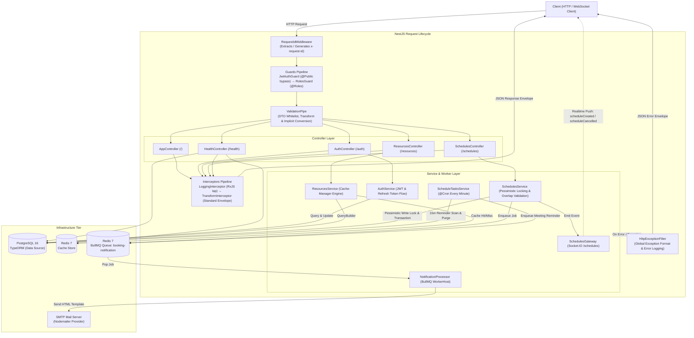
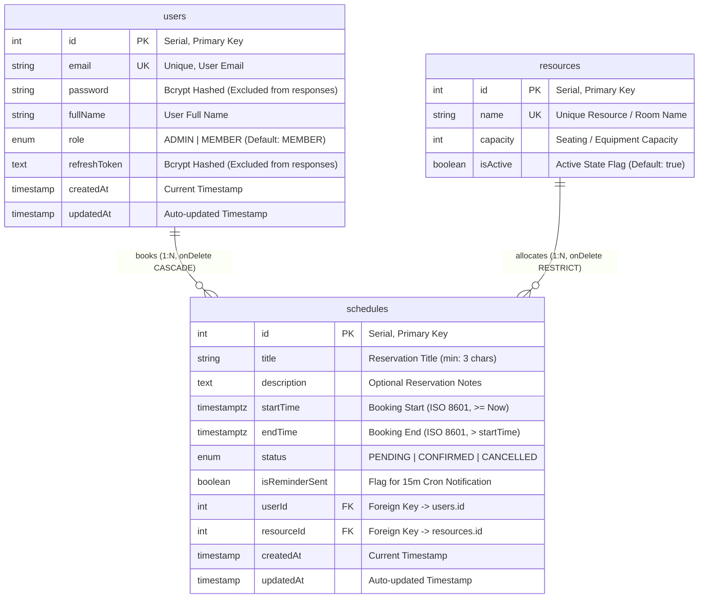

<div align="center">

#  Nền tảng Đặt lịch & Quản lý Tài nguyên Doanh nghiệp

> Dự án backend NestJS chuẩn production chuyên sâu minh họa Khóa bi quan (Pessimistic Concurrency Locking), Rollback giao dịch (Transactional Rollback), Realtime WebSocket, Hàng đợi phân tán BullMQ, Caching đa tầng và Quản trị toàn diện Vòng đời Request (End-to-End Request Lifecycle Governance).

[](https://nestjs.com/)
[](https://www.typescriptlang.org/)
[](https://www.postgresql.org/)
[](https://redis.io/)
[](https://bullmq.io/)
[](https://socket.io/)
[](http://localhost:3000/api/docs)

</div>

---

##  Mục lục

- [Tổng quan & Vấn đề giải quyết](#-tổng-quan--vấn-đề-giải-quyết)
- [Kiến trúc hệ thống](#-kiến-trúc-hệ-thống)
- [Database Schema & ERD](#-database-schema--erd)
- [Điểm nhấn kỹ thuật cốt lõi](#-điểm-nhấn-kỹ-thuật-cốt-lõi)
- [Công nghệ sử dụng](#-công-nghệ-sử-dụng)
- [Cấu trúc thư mục](#-cấu-trúc-thư-mục)
- [Yêu cầu hệ thống](#-yêu-cầu-hệ-thống)
- [Cài đặt & Khởi chạy nhanh](#-cài-đặt--khởi-chạy-nhanh)
- [Cấu hình môi trường (.env)](#-cấu-hình-môi-trường-env)
- [Database Migrations & Seeding](#-database-migrations--seeding)
- [Danh sách Scripts](#-danh-sách-scripts)
- [Tài liệu API](#-tài-liệu-api)
  - [Xác thực (`/auth`)](#1-xác-thực-auth)
  - [Quản lý tài nguyên (`/resources`)](#2-quản-lý-tài-nguyên-resources)
  - [Lịch trình & Đặt chỗ (`/schedules`)](#3-lịch-trình--đặt-chỗ-schedules)
  - [Kiểm tra sức khỏe hệ thống (`/health`)](#4-kiểm-tra-sức-khỏe-hệ-thống-health)
  - [Đặc tả Realtime WebSocket (`/schedules`)](#5-đặc-tả-realtime-websocket-schedules)
- [Kiểm thử & Đảm bảo chất lượng](#-kiểm-thử--đảm-bảo-chất-lượng)
- [Tài liệu thực hành Lab](#-tài-liệu-thực-hành-lab)
- [Xử lý sự cố (Troubleshooting)](#-xử-lý-sự-cố-troubleshooting)
- [Giấy phép (License)](#-giấy-phép-license)

---

##  Tổng quan & Vấn đề giải quyết

Trong môi trường doanh nghiệp có lượng truy cập đồng thời cao (high concurrency), các hệ thống đặt phòng họp và tài nguyên dùng chung thường xuyên gặp phải tình trạng **race conditions**, **xung đột trùng lịch (double-booking)**, **thất lạc thông báo**, và **dữ liệu lịch trình bị cũ (stale projections)**. 

Dự án này giải quyết các thách thức kiến trúc trên thông qua:
1. **Kiểm soát đồng thời bằng Khóa bi quan (Pessimistic Concurrency Control)**: Loại bỏ hoàn toàn các lượt đặt chỗ trùng lặp ngay tại tầng cơ sở dữ liệu với khóa ghi cấp độ dòng (row-level write locks: `SELECT ... FOR UPDATE`).
2. **Đảm bảo tính toàn vẹn giao dịch ACID**: Đóng gói các thao tác sửa đổi lịch trình vào các transaction database cô lập với cơ chế tự động rollback khi xảy ra lỗi.
3. **Tách biệt tác vụ nền (Decoupled Background Tasks)**: Chuyển các tác vụ gửi email xác nhận và nhắc nhở cuộc họp sang hàng đợi worker phân tán **BullMQ** chạy trên nền Redis với cơ chế tự động thử lại (retry) và giãn cách số mũ (exponential backoff).
4. **Phát sóng thời gian thực (Realtime Broadcasts)**: Lan truyền các thay đổi lịch đặt ngay lập tức thông qua cơ chế đăng ký phòng (room subscriptions: `resource_{id}`) của **Socket.IO**.
5. **Chuẩn hóa vòng đời Request (Standardized Request Lifecycle)**: Thiết lập ranh giới AOP chặt chẽ với Request-ID correlation, phân quyền khai báo theo vai trò (Declarative Role-Based Access Control - `@Roles()`), custom parameter decorator (`@CurrentUser()`), chuẩn hóa định dạng phản hồi (response envelope tập trung) và xử lý ngoại lệ có cấu trúc.

---

##  Kiến trúc hệ thống

Sơ đồ dưới đây minh họa toàn bộ luồng thực thi xuyên suốt Vòng đời Request của NestJS và sự tích hợp với PostgreSQL, Redis cùng các dịch vụ ngoại vi:



---

##  Database Schema & ERD

Schema cơ sở dữ liệu được quản lý thông qua TypeORM với các ràng buộc khóa ngoại nghiêm ngặt, xóa theo tầng (cascade delete) tại các vị trí thích hợp, và đánh chỉ mục kết hợp (composite indexing) trên các khoảng thời gian đặt lịch.



> **Lưu ý hiệu năng**: Bảng `schedules` sử dụng một composite index trên các trường `[resourceId, startTime, endTime]` nhằm tăng tốc tối đa các truy vấn kiểm tra xung đột lịch khi có lượng yêu cầu đặt chỗ dồn dập.

---

##  Điểm nhấn kỹ thuật cốt lõi

### 1. Kiểm soát đồng thời với Khóa bi quan (Pessimistic Locking)
Để ngăn chặn bài toán double-booking kinh điển khi hai request đồng thời đặt cùng một tài nguyên trong các khoảng thời gian chồng lấn, [`SchedulesService.create()`](src/schedules/schedules.service.ts) sẽ khóa dòng dữ liệu của tài nguyên mục tiêu trong một transaction của database:
```typescript
await this.dataSource.transaction(async (manager) => {
  const resource = await manager
    .getRepository(Resource)
    .createQueryBuilder('resource')
    .setLock('pessimistic_write') // Row-level SELECT ... FOR UPDATE
    .where('resource.id = :id', { id: resourceId })
    .getOne();

  // Validate overlapping intervals against CONFIRMED and PENDING schedules
  // Save new schedule atomically
});
```

### 2. Mô phỏng Transactional Rollback
Endpoint chuyên biệt `POST /schedules/test-rollback` được thiết kế để minh họa khả năng rollback nguyên tử (atomic rollback) của database. Endpoint này khởi tạo transaction, lấy khóa dòng, tạo một entity, sau đó ném ra một ngoại lệ có chủ đích trước khi commit, từ đó kiểm chứng không có dữ liệu rác hay trạng thái bẩn nào bị lưu trữ dai dẳng.

### 3. Máy trạng thái hữu hạn cho trạng thái lịch đặt (Finite State Machine)
Các chuyển đổi giữa các trạng thái được thực thi bằng logic kiểm tra nghiêm ngặt:
- `PENDING` &rarr; `CONFIRMED` hoặc `CANCELLED`
- `CONFIRMED` &rarr; `CANCELLED`
- `CANCELLED` &rarr; Trạng thái kết thúc (mọi chỉnh sửa tiếp theo đều bị từ chối với mã HTTP 400).

### 4. Xử lý tác vụ nền tin cậy (BullMQ + Redis)
Email xác nhận và thông báo nhắc họp được ủy quyền cho hàng đợi BullMQ mang tên `'booking-notification'`:
- **Idempotency Key**: Mỗi job sử dụng một `jobId` định danh duy nhất (ví dụ: `schedule_${id}`, `reminder_${id}`) giúp ngăn chặn việc gửi trùng lặp thông báo.
- **Khả năng tự phục hồi (Resilience)**: Tự động thử lại 3 lần với cơ chế giãn cách số mũ (exponential backoff: `delay: 2000ms`).

### 5. Tự động lập lịch & Dọn dẹp dữ liệu (@Cron)
Một cron job chạy định kỳ mỗi phút ([`ScheduleTasksService`](src/schedules/tasks/schedule-tasks.service.ts)) thực hiện 2 nhiệm vụ bảo trì:
1. **Chủ động nhắc lịch**: Truy vấn các lịch đặt đã xác nhận sắp diễn ra trong khoảng `[T + 14m, T + 15m]`, đẩy các job nhắc nhở vào BullMQ và cập nhật `isReminderSent = true`.
2. **Dọn dẹp lịch hết hạn**: Tìm các lịch ở trạng thái `PENDING` chưa được xác nhận nhưng đã quá hạn (`startTime < NOW()`) và đánh dấu thành `CANCELLED`.

### 6. Minh bạch hóa Vòng đời Request & Chuẩn hóa Response Envelope
Mọi gói tin gửi đến và phản hồi đi đều đi qua một pipeline có cấu trúc chặt chẽ:
- **`x-request-id`**: Xử lý bởi [`RequestIdMiddleware`](src/common/middlewares/request-id.middleware.ts) phục vụ truy vết phân tán (distributed tracing).
- **Chuẩn hóa Envelope đồng nhất**: Xử lý bởi [`TransformInterceptor`](src/common/interceptors/transform.interceptor.ts):
  ```json
  {
    "success": true,
    "statusCode": 200,
    "data": { ... },
    "timestamp": "2026-10-23T04:20:00.000Z"
  }
  ```
- **Ghi log thời gian thực thi**: Xử lý bởi [`LoggingInterceptor`](src/common/interceptors/logging.interceptor.ts) ghi nhận method, route và thời gian xử lý (ms) qua toán tử RxJS `tap`.

---

## 🛠️ Công nghệ sử dụng

| Category | Technology | Purpose |
| :--- | :--- | :--- |
| **Framework** | [NestJS 11.0.1](https://nestjs.com/) | Modular enterprise Node.js framework (Express platform) |
| **Language** | [TypeScript 5.7.3](https://www.typescriptlang.org/) | Strongly-typed JavaScript with decorator reflection |
| **Database** | [PostgreSQL 16](https://www.postgresql.org/) | Relational database with ACID transaction support |
| **ORM** | [TypeORM 0.3.31](https://typeorm.io/) | Schema management, migrations, and QueryBuilder |
| **Caching** | [Cache-Manager](https://github.com/node-cache-manager/node-cache-manager) + [@keyv/redis 5.1](https://github.com/jaredwray/keyv) | In-memory and Redis-backed query caching |
| **Queue & Worker** | [BullMQ 5.41](https://bullmq.io/) + Redis 7 | Distributed job queue with idempotency and retry |
| **Realtime** | [Socket.IO 4.8](https://socket.io/) + [@nestjs/websockets](https://docs.nestjs.com/websockets/gateways) | Low-latency bi-directional room communication |
| **Authentication** | [Passport JWT 4.0](http://www.passportjs.org/) + [bcrypt 6.0](https://github.com/kelektiv/node.bcrypt.js) | Dual Access/Refresh token architecture with password salting |
| **Validation** | [class-validator 0.15](https://github.com/typestack/class-validator) + [class-transformer 0.5](https://github.com/typestack/class-transformer) | Declarative DTO schema validation and transformation |
| **Task Scheduling**| [@nestjs/schedule 6.1](https://docs.nestjs.com/techniques/task-scheduling) | Cron-based background task runner |
| **Mailing** | [@nestjs-modules/mailer 3.0](https://github.com/nest-modules/mailer) + [Nodemailer 10.2](https://nodemailer.com/) | Templated HTML email dispatching |
| **Documentation** | [Swagger / OpenAPI 3.0](https://swagger.io/) ([@nestjs/swagger 11.4](https://docs.nestjs.com/openapi/introduction)) | Interactive API exploration at `/api/docs` |
| **Health Checks** | [@nestjs/terminus 11.1](https://docs.nestjs.com/recipes/terminus) | Liveness & readiness probes (Database, Redis, Memory RSS/Heap) |
| **Testing** | [Jest 30.0](https://jestjs.io/) + [Supertest 7.0](https://github.com/ladjs/supertest) | Unit, integration, and E2E test suites |

---

##  Cấu trúc thư mục

```text
CCNLTHD_Nestjs/
├── src/
│   ├── app.controller.ts            # Root greeting & admin-only verification routes
│   ├── app.module.ts                # Root application module wiring all dependencies
│   ├── data-source.ts               # TypeORM CLI DataSource configuration
│   ├── main.ts                      # Bootstrap entry point (ValidationPipe, Swagger)
│   ├── auth/                        # JWT authentication, register, login, refresh
│   │   ├── dto/                     # LoginDto, RegisterDto, RefreshTokenDto
│   │   ├── strategies/              # JwtStrategy (Passport extraction & payload validation)
│   │   ├── auth.controller.ts
│   │   ├── auth.module.ts
│   │   └── auth.service.ts
│   ├── common/                      # Cross-cutting concerns (Request Lifecycle)
│   │   ├── decorators/              # @CurrentUser(), @Public(), @Roles()
│   │   ├── filters/                 # HttpExceptionFilter (global envelope for errors)
│   │   ├── guards/                  # JwtAuthGuard, RolesGuard
│   │   ├── interceptors/            # LoggingInterceptor, TransformInterceptor
│   │   └── middlewares/             # RequestIdMiddleware (x-request-id header)
│   ├── health/                      # Terminus health checks (DB, Redis, Memory)
│   │   ├── health.controller.ts
│   │   ├── health.module.ts
│   │   └── redis.health.ts
│   ├── migrations/                  # Version-controlled TypeORM database migrations
│   ├── notifications/               # BullMQ background worker for email dispatch
│   │   ├── notification.processor.ts# Job handler for confirmation & reminders
│   │   └── notifications.module.ts
│   ├── resources/                   # Rooms & physical assets management
│   │   ├── dto/                     # CreateResourceDto, UpdateResourceDto, QueryResourceDto
│   │   ├── entities/                # Resource TypeORM entity
│   │   ├── resources.controller.ts
│   │   ├── resources.module.ts
│   │   └── resources.service.ts     # Redis caching integration
│   ├── schedules/                   # Core booking & reservation module
│   │   ├── dto/                     # CreateScheduleDto, UpdateScheduleDto, QueryScheduleDto
│   │   ├── entities/                # Schedule TypeORM entity with composite index
│   │   ├── enums/                   # ScheduleStatus (PENDING, CONFIRMED, CANCELLED)
│   │   ├── gateways/                # SchedulesGateway (WebSocket /schedules namespace)
│   │   ├── guards/                  # ScheduleOwnershipGuard (Admin or Creator)
│   │   ├── tasks/                   # ScheduleTasksService (Cron reminders & cleanup)
│   │   ├── validators/              # @IsAfter(), @IsNotPastDate() custom validators
│   │   ├── schedules.controller.ts
│   │   ├── schedules.module.ts
│   │   └── schedules.service.ts     # Pessimistic locking & overlap checks
│   ├── seeds/                       # Database seeding script & utilities
│   │   └── script.ts
│   ├── swagger/                     # OpenAPI documentation setup & decorator helpers
│   └── users/                       # User entity, roles enum, and user repository
├── test/                            # E2E test suites & interactive WebSocket test client
│   ├── app.e2e-spec.ts              # Comprehensive REST API integration test
│   ├── schedules.gateway.e2e-spec.ts# WebSocket realtime test suite
│   └── ws-multi-client-tester.html  # Multi-client browser testing harness
├── docker-compose.yml               # Containerized PostgreSQL 16 & Redis 7 services
├── package.json                     # NPM dependencies, scripts, and build metadata
├── tsconfig.json                    # TypeScript compiler options
└── HANDS_ON_LAB.md                  # Comprehensive educational lab guide (D0-D3)
```

---

##  Yêu cầu hệ thống

Trước khi khởi chạy ứng dụng, hãy đảm bảo các môi trường thực thi và công cụ sau đã được cài đặt:
- **Node.js**: `v18.x`, `v20.x`, hoặc `v22.x` (đã kiểm chứng trên `v22.15.0`).
- **NPM**: `v9.x` hoặc `v10.x` (đã kiểm chứng trên `v10.9.2`).
- **Docker & Docker Compose**: Dùng để khởi tạo các container PostgreSQL 16 và Redis 7.

---

##  Cài đặt & Khởi chạy nhanh

Thực hiện theo các bước sau để thiết lập và chạy dự án ở môi trường local:

### 1. Clone repository
```bash
git clone https://github.com/minhmhit/CCNLTHD_Nestjs.git
cd CCNLTHD_Nestjs
```

### 2. Cài đặt các gói phụ thuộc (dependencies)
```bash
npm install
```

### 3. Khởi chạy các dịch vụ hạ tầng (Docker)
Khởi động cơ sở dữ liệu PostgreSQL và máy chủ Redis bằng tệp `docker-compose.yml` có sẵn:
```bash
docker compose up -d
```
*Kiểm tra trạng thái các container đang chạy:*
```bash
docker compose ps
```

### 4. Cấu hình biến môi trường
Sao chép tệp mẫu biến môi trường sang tệp `.env`:
```bash
cp .env.example .env
```
*(Trên Windows PowerShell: `Copy-Item .env.example .env`)*

### 5. Chạy database migrations & nạp dữ liệu mẫu (seed)
Thực thi các migration của TypeORM để tạo bảng và chạy script seed để khởi tạo sẵn tài khoản cùng phòng họp:
```bash
npm run migration:run
npm run seed
```

### 6. Khởi động development server
```bash
npm run start:dev
```

Ứng dụng sẽ khởi chạy tại `http://localhost:3000`.
- **API Base URL**: `http://localhost:3000`
- **Tài liệu Swagger**: `http://localhost:3000/api/docs`
- **Endpoint kiểm tra sức khỏe**: `http://localhost:3000/health`
- **WebSocket Namespace**: `ws://localhost:3000/schedules`

---

##  Cấu hình môi trường (.env)

Ứng dụng sử dụng [`@nestjs/config`](https://docs.nestjs.com/techniques/configuration) để nạp các khóa cấu hình từ tệp `.env`. Toàn bộ các tham số cấu hình được mô tả dưới đây:

| Environment Variable | Description | Default / Example Value |
| :--- | :--- | :--- |
| `NODE_ENV` | Application runtime environment | `development` |
| `PORT` | HTTP Server port (optional, fallback: 3000) | `3000` |
| `DB_HOST` | PostgreSQL host address | `localhost` |
| `DB_PORT` | PostgreSQL port | `5432` |
| `DB_USER` | PostgreSQL username | `admin` |
| `DB_PASSWORD` | PostgreSQL password | `admin123` |
| `DB_NAME` | PostgreSQL database name | `schedule_app` |
| `JWT_SECRET` | HMAC secret for signing JWT Access Tokens | `your_jwt_access_secret_key_here` |
| `JWT_EXPIRES_IN` | Validity duration of Access Tokens | `5m` |
| `JWT_REFRESH_SECRET` | HMAC secret for signing Refresh Tokens | `your_jwt_refresh_secret_key_here` |
| `JWT_REFRESH_EXPIRES_IN`| Validity duration of Refresh Tokens | `1h` |
| `REDIS_HOST` | Redis cache and BullMQ broker host | `localhost` |
| `REDIS_PORT` | Redis broker port | `6379` |
| `MAIL_HOST` | SMTP server host | `smtp.gmail.com` |
| `MAIL_PORT` | SMTP server port | `587` |
| `MAIL_USER` | SMTP authentication username / email | `your_email@example.com` |
| `MAIL_PASS` | SMTP authentication app password | `your_app_password` |
| `MAIL_FROM` | Sender display name and address | `"Scheduling App <no-reply@scheduling.com>"` |

> [!WARNING]
> Tuyệt đối không commit các khóa bí mật thực tế hoặc thông tin đăng nhập production lên hệ thống quản lý phiên bản (Git). Hãy luôn đảm bảo tệp `.env` đã được liệt kê trong `.gitignore`.

---

##  Database Migrations & Seeding

Ứng dụng quản lý schema quan hệ thông qua các lệnh TypeORM CLI được khai báo trong `package.json`:

```bash
# Run all pending migrations
npm run migration:run

# Revert the most recently executed migration
npm run migration:revert

# Generate a new migration based on schema diffs
npm run migration:generate -- src/migrations/YourMigrationName

# Seed the database with default accounts and conference rooms
npm run seed
```

### Tài khoản được tạo sẵn (Khả dụng sau khi chạy `npm run seed`)
| Email | Password | Role | Description |
| :--- | :--- | :--- | :--- |
| `admin@example.com` | `password123` | `ADMIN` | System administrator with full access to resources and bookings |
| `member1@example.com` | `password123` | `MEMBER` | Standard user (Nguyen Van A) |
| `member2@example.com` | `password123` | `MEMBER` | Standard user (Tran Thi B) |

### Các phòng họp được tạo sẵn
- **Phòng họp Tokyo**: Sức chứa 10 chỗ ngồi, `isActive: true`
- **Hội trường Diamond**: Sức chứa 100 chỗ ngồi, `isActive: true`
- **Phòng Ban cố vấn**: Sức chứa 6 chỗ ngồi, `isActive: false`

---

##  Danh sách Scripts

Tất cả các script khai báo trong `package.json` đều đã được kiểm chứng và mô tả dưới đây:

| Command | Action |
| :--- | :--- |
| `npm run start` | Starts the application with Nest CLI |
| `npm run start:dev` | Starts the application in watch mode (auto-reload on file edits) |
| `npm run start:debug` | Starts the application in debug mode with Node inspector |
| `npm run start:prod` | Runs the compiled production bundle (`node dist/main`) |
| `npm run build` | Compiles TypeScript sources to the `dist/` directory |
| `npm run format` | Formats all `.ts` files using Prettier |
| `npm run lint` | Analyzes code quality and fixes issues via ESLint |
| `npm test` | Runs unit tests with Jest |
| `npm run test:watch` | Runs Jest in interactive watch mode |
| `npm run test:cov` | Generates unit test coverage reports |
| `npm run test:e2e` | Runs comprehensive End-to-End integration tests |
| `npm run seed` | Executes the database seed script |

---

##  Tài liệu API

Tất cả các phản hồi thành công đều được bọc trong cấu trúc chuẩn của `TransformInterceptor`. Tất cả các endpoint (ngoại trừ các endpoint được gắn cờ `@Public()`) đều yêu cầu Bearer JWT Access Token hợp lệ truyền qua header `Authorization`:
```text
Authorization: Bearer <accessToken>
```

### 1. Xác thực (`/auth`)

| Method | Endpoint | Access | Description |
| :--- | :--- | :--- | :--- |
| `POST` | `/auth/register` | `@Public()` | Register a new account (`email`, `password`, `fullName`). |
| `POST` | `/auth/login` | `@Public()` | Authenticate user; returns `accessToken`, `refreshToken`, and user info. |
| `POST` | `/auth/refresh` | `@Public()` | Exchange a valid `refreshToken` for a new token pair. |
| `POST` | `/auth/logout` | Authenticated | Invalidate stored refresh token for the current user. |
| `GET` | `/auth/profile` | Authenticated | Retrieve token payload of the currently logged-in user. |

#### Ví dụ: Request & Response Đăng nhập
```bash
curl -X POST http://localhost:3000/auth/login \
  -H "Content-Type: application/json" \
  -d '{
    "email": "admin@example.com",
    "password": "password123"
  }'
```

**Phản hồi (HTTP 200 OK):**
```json
{
  "success": true,
  "statusCode": 200,
  "data": {
    "accessToken": "eyJhbGciOiJIUzI1NiIsInR5cCI6IkpXVCJ9...",
    "refreshToken": "eyJhbGciOiJIUzI1NiIsInR5cCI6IkpXVCJ9...",
    "user": {
      "id": 1,
      "email": "admin@example.com",
      "fullName": "Admin System",
      "role": "ADMIN",
      "createdAt": "2026-10-23T04:00:00.000Z",
      "updatedAt": "2026-10-23T04:00:00.000Z"
    }
  },
  "timestamp": "2026-10-23T04:00:00.000Z"
}
```

---

### 2. Quản lý tài nguyên (`/resources`)

| Method | Endpoint | Access | Description |
| :--- | :--- | :--- | :--- |
| `GET` | `/resources` | Authenticated | Query resources (Cached in Redis on default query). Query params: `page`, `limit`, `name`, `minCapacity`, `maxCapacity`, `isActive`. |
| `GET` | `/resources/:id` | Authenticated | Retrieve resource details by ID. |
| `POST` | `/resources` | `Role.ADMIN` | Create a new room/resource (`name`, `capacity`, `isActive`). Invalidates Redis cache. |
| `PATCH`| `/resources/:id` | `Role.ADMIN` | Update resource attributes. Invalidates Redis cache. |
| `DELETE`| `/resources/:id`| `Role.ADMIN` | Delete resource by ID. Invalidates Redis cache. |

---

### 3. Lịch trình & Đặt chỗ (`/schedules`)

| Method | Endpoint | Access | Description |
| :--- | :--- | :--- | :--- |
| `GET` | `/schedules` | Authenticated | Paginated query of bookings with `user` and `resource` relations. Query params: `page`, `limit`, `resourceId`, `from`, `to`. |
| `GET` | `/schedules/:id` | Authenticated | Retrieve schedule by ID. |
| `POST` | `/schedules` | Authenticated | Create a booking with pessimistic lock, overlap check, BullMQ notification, and WebSocket emit. |
| `POST` | `/schedules/test-rollback` | Authenticated | Simulates transactional rollback under simulated failure. |
| `PATCH`| `/schedules/:id` | Admin or Creator | Update schedule time or room. Validates non-overlapping intervals. |
| `PATCH`| `/schedules/:id/status`| Admin or Creator | Update status (`PENDING` &rarr; `CONFIRMED` &rarr; `CANCELLED`). |
| `DELETE`| `/schedules/:id` | Admin or Creator | Soft-cancel booking (sets status to `CANCELLED` and broadcasts event). |

#### Ví dụ: Request Tạo mới lịch đặt
```bash
curl -X POST http://localhost:3000/schedules \
  -H "Authorization: Bearer <accessToken>" \
  -H "Content-Type: application/json" \
  -d '{
    "title": "Họp Kế Hoạch Quý 4",
    "description": "Thảo luận chiến lược kinh doanh và ra mắt tính năng mới",
    "resourceId": 1,
    "startTime": "2026-11-01T09:00:00.000Z",
    "endTime": "2026-11-01T10:30:00.000Z"
  }'
```

**Phản hồi (HTTP 201 Created):**
```json
{
  "success": true,
  "statusCode": 201,
  "data": {
    "id": 10,
    "title": "Họp Kế Hoạch Quý 4",
    "description": "Thảo luận chiến lược kinh doanh và ra mắt tính năng mới",
    "startTime": "2026-11-01T09:00:00.000Z",
    "endTime": "2026-11-01T10:30:00.000Z",
    "status": "CONFIRMED",
    "isReminderSent": false,
    "userId": 2,
    "resourceId": 1,
    "createdAt": "2026-10-23T04:15:00.000Z",
    "updatedAt": "2026-10-23T04:15:00.000Z"
  },
  "timestamp": "2026-10-23T04:15:00.000Z"
}
```

---

### 4. Kiểm tra sức khỏe hệ thống (`/health`)

| Method | Endpoint | Access | Description |
| :--- | :--- | :--- | :--- |
| `GET` | `/health` | `@Public()` | Terminus health check evaluating database connectivity, Redis ping, heap memory (< 300MB), and RSS memory (< 500MB). |

**Phản hồi (HTTP 200 OK):**
```json
{
  "status": "ok",
  "info": {
    "database": { "status": "up" },
    "redis": { "status": "up" },
    "memory_heap": { "status": "up" },
    "memory_rss": { "status": "up" }
  },
  "error": {},
  "details": {
    "database": { "status": "up" },
    "redis": { "status": "up" },
    "memory_heap": { "status": "up" },
    "memory_rss": { "status": "up" }
  }
}
```

---

### 5. Đặc tả Realtime WebSocket (`/schedules`)

WebSocket Gateway hoạt động dưới namespace `/schedules` và yêu cầu JWT Token hợp lệ trong quá trình bắt tay (handshake):

- **URL kết nối**: `ws://localhost:3000/schedules` (Transports: `websocket`, `polling`)
- **Xác thực Handshake**: `auth: { token: "<accessToken>" }` hoặc `headers: { authorization: "Bearer <accessToken>" }`

#### Client-to-Server Events
| Event | Payload | Description |
| :--- | :--- | :--- |
| `joinRoom` | `{ "resourceId": 1 }` or `1` | Subscribes client socket to `resource_1` room for live updates |
| `leaveRoom` | `{ "resourceId": 1 }` or `1` | Unsubscribes client socket from `resource_1` room |

#### Server-to-Client Broadcast Events
| Event | Target Room | Payload | Description |
| :--- | :--- | :--- | :--- |
| `scheduleCreated` | `resource_{id}` | `Schedule` Object | Broadcasted when a new booking is created |
| `scheduleCancelled`| `resource_{id}` | `{ id: number }` | Broadcasted when a booking is cancelled or removed |

---

##  Kiểm thử & Đảm bảo chất lượng

Dự án bao gồm bộ kiểm thử toàn diện với unit test và integration test:

```bash
# Run unit tests
npm test

# Run tests with code coverage report
npm run test:cov

# Run End-to-End (E2E) tests
npm run test:e2e
```

### Giao diện kiểm thử WebSocket đa client
Giao diện kiểm thử đa client trên trình duyệt được xây dựng sẵn tại [`test/ws-multi-client-tester.html`](test/ws-multi-client-tester.html). Hãy mở tệp này trực tiếp trên bất kỳ trình duyệt hiện đại nào để mô phỏng các client đồng thời tham gia vào các room channel và quan sát các sự kiện phát sóng theo thời gian thực.

---

##  Tài liệu thực hành Lab

Kho mã nguồn này đi kèm giáo trình thực hành hoàn chỉnh đạt chuẩn giảng dạy đại học, được thiết kế để truyền tải các nguyên lý nền tảng của **NestJS Request Lifecycle**:

- **Tài liệu Markdown**: [HANDS_ON_LAB.md](HANDS_ON_LAB.md)
- **Mã nguồn LaTeX**: [HANDS_ON_LAB.tex](HANDS_ON_LAB.tex)

Nội dung giáo trình bao gồm:
- Thiết kế các Custom Decorator mang tính khai báo (`@Roles()`, `@CurrentUser()`, `@Public()`).
- Phản chiếu Metadata (Reflection) bằng `Reflector.getAllAndOverride()`.
- Xây dựng Guards kiểm soát truy cập dựa trên vai trò (RBAC `CanActivate`).
- Chuyển đổi định dạng phản hồi (Transform Response) bằng các toán tử RxJS trong Interceptor.
- 4 kịch bản gỡ lỗi (troubleshooting) thực tế kèm hướng dẫn giải quyết thử thách.

---

##  Xử lý sự cố (Troubleshooting)

### 1. Lỗi từ chối kết nối Redis (`ECONNREFUSED 127.0.0.1:6379`)
- **Nguyên nhân**: Container Redis chưa được khởi chạy hoặc cổng 6379 đã bị chiếm dụng bởi tiến trình khác.
- **Giải pháp**: Khởi chạy lại với `docker compose up -d redis` và kiểm tra log bằng lệnh `docker compose logs redis`.

### 2. Lỗi kết nối cơ sở dữ liệu (`password authentication failed for user "admin"`)
- **Nguyên nhân**: Volume dữ liệu PostgreSQL cũ còn lưu thông tin xác thực khác với cấu hình hiện tại.
- **Giải pháp**: Dừng container, xóa volume dữ liệu cũ (`docker compose down -v`), sau đó khởi động lại với `docker compose up -d`. Tiếp tục chạy lại migration và seed dữ liệu.

### 3. BullMQ Worker không xử lý công việc
- **Nguyên nhân**: Sai cấu hình kết nối Redis hoặc thiếu thông tin cấu hình tài khoản SMTP.
- **Giải pháp**: Kiểm tra log trên console để theo dõi các nỗ lực xử lý của `[BullMQ Worker]`. BullMQ sẽ tự động thử lại tối đa 3 lần trước khi đưa job vào danh sách lỗi (failed set).

### 4. Xung đột đặt lịch trùng lặp (`409 Conflict`)
- **Nguyên nhân**: Phòng được chọn đã có người đặt trong khoảng thời gian yêu cầu.
- **Giải pháp**: Kiểm tra các lịch đặt hiện có của tài nguyên qua API `GET /schedules?resourceId=:id` và chọn một khoảng thời gian khác không bị chồng lấn.

---

##  Giấy phép (License)

Repository này là dự án nội bộ (private) và được cấp phép dưới dạng **UNLICENSED** như được chỉ định trong [`package.json`](package.json). Mọi quyền được bảo lưu (All rights reserved).
